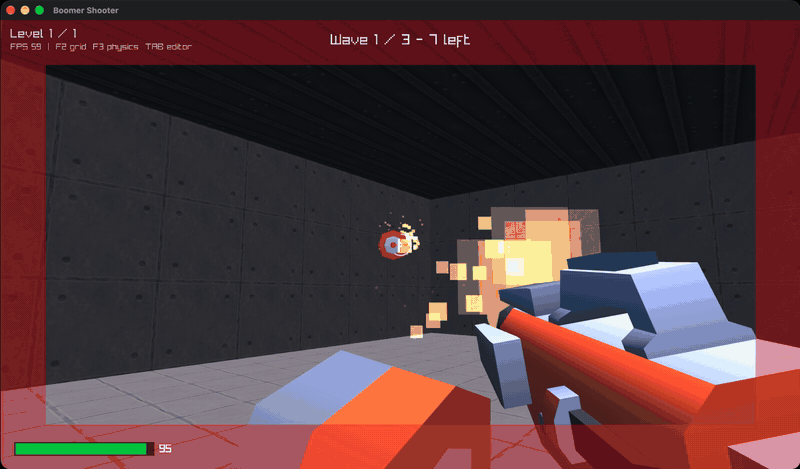
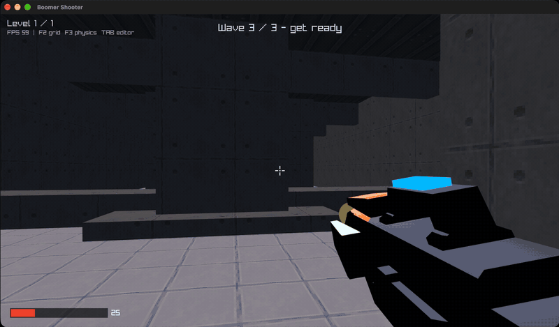
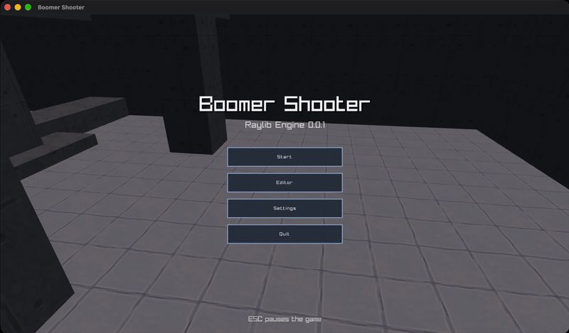

# Boomer Shooter

An arena FPS (placeholder name) with a small C++ game engine underneath, for macOS on Apple silicon.
You spawn in a lit 16×6×16 arena and fight three waves of enemies with a hitscan blaster. **Left click** fires a
tracer; the crosshair turns red when the aim is on an enemy. Clear all three waves to win; if your health reaches 0 you lose.

The game is built on [raylib](https://www.raylib.com/) (window, input, rendering, audio, raygui) and
[Bullet Physics](https://github.com/bulletphysics/bullet3) 3.25. Everything is linked statically: a build needs
nothing installed besides the Command Line Tools and CMake.

[](docs/game_1.mov)

## Gameplay

- **Player:** first-person walk and jump, 100 HP.
- **Gun:** hitscan, 4 shots per second, 10 damage per shot, with a tracer, muzzle flash and a cooldown ring on the crosshair.
- **Enemies:** three types, each with its own speed, health, sight range and damage. They idle, wander, chase you
  when you come close or shoot them, and attack in melee.

  [](docs/game_2.mov)

  | | Drifter | Stalker | Brute |
  |---|---|---|---|
  | Health (shots to kill) | 30 (3) | 60 (6) | 120 (12) |
  | Chase speed | 6.0 m/s | 4.5 m/s | 3.5 m/s |
  | Damage per hit | 5 | 10 | 20 |

- **Waves:** three waves of 7, 7 and 6 enemies, spawned one by one at the arena's spawn points. The HUD shows your
  health, the wave and the enemies left.

[](docs/game_0.mov)

## Controls

| Input | Action |
|---|---|
| **W A S D** / arrows | Walk |
| **Mouse** | Look |
| **Space** | Jump |
| **Left click** | Fire |
| **ESC** | Pause / resume |

Settings (mouse sensitivity, volumes, fullscreen) are in the main menu and the pause menu and are saved to
`~/Library/Application Support/BoomerShooter/settings.cfg`.

## How this project was built: AI-driven development

The whole game was built in a loop between the developer and an AI coding assistant ([Claude Code](https://claude.com/claude-code)).
The developer owns every decision; the assistant plans, writes code and documents. Each feature went through the same steps:

1. **Task.** The developer writes a task file (`docs/tasks/`) with the goal, the inputs and the criteria.
2. **Architecture plan.** The assistant reads the code and writes an architecture plan (`docs/deliverables/*_ARCHITECTURE_PLAN.md`):
   the decisions taken, what changes, the diagrams, the risks, and the work split into phases. The developer reviews it
   and answers the open questions.
3. **Development tracker.** The approved plan becomes a `*_DEV_PROGRESS.md` checklist, one phase per section,
   each with a *Done when* check.
4. **Implementation, phase by phase.** One local git branch per phase, cut from `integration`; one commit per checkbox.
   The assistant never ticks *Done when*: the developer plays the branch and gives the green light (or feedback, which
   becomes new commits, never amended ones).
5. **Merge and archive.** An approved phase is merged into `integration` and its branch is renamed `done/<name>`.
   The branches are kept, so the history of the process stays in git. A dev log in `docs/devlogs/` records what was built and why.

The recurring steps are packaged as project skills in `.claude/skills/` (`write-dev-progress`, `follow-dev-progress`),
and `CLAUDE.md` holds the project rules the assistant follows. Finished tasks, plans and trackers are in `docs/tasks/done/`.

## Architecture overview

Two layers on top of raylib and Bullet. The engine (`src/engine`, namespace `eng`) never includes anything from the
game; the game (`src/game`) reaches the engine only through the public header `eng.h`, and never touches Bullet.

```
+=====================================================================================+
|                      GAME LAYER   (src/game)                                        |
|                                                                                     |
|   ArenaGame : eng::Application   (registers components, wires and owns the systems)  |
|   +--------------+ +-------------+ +--------------+ +-------------+ +------------+  |
|   | state/       | | flow/       | | player/      | | enemies/    | | ui/ audio/ |  |
|   | GameState    | | Gameplay-   | | PlayerInput  | | EnemyManager| | GameUI     |  |
|   | PlayerState  | |  Manager    | | PlayerActor  | | EnemyPool   | | GunHUD     |  |
|   | Settings     | | TriggerZone | | FirstPerson- | | WaveDirector| | Settings-  |  |
|   | SoundFXBank  | | GameContext | |  Controller  | | ai/ systems/| |  Screen    |  |
|   | LevelList    | |             | | Gun, GunView | |  (tiny ECS) | | Music-     |  |
|   +--------------+ +-------------+ +--------------+ +-------------+ |  Manager   |  |
|   fx/ (Tracer, MuzzleFX, ShotFXSpawner)    dev/ (console commands)  +------------+  |
+==========================================^==========================================+
                                           |  #include <eng.h>
+==========================================|==========================================+
|                         ENGINE   (src/engine, namespace eng)                        |
|                                                                                     |
|   core/     Engine (singleton, owns every subsystem), Time, Window, EventBus, Log   |
|   modes/    ModeMachine:  MainMenu <-> Play <-> Paused,   Play <-TAB-> Editor       |
|   input/    InputManager        resources/  ResourceManager (cache, models, shader) |
|   render/   RenderQueue, Material, MeshRenderer, Camera, DebugDraw, lit shader      |
|   level/    Level, GameActor, Component, ComponentRegistry, LevelSerializer         |
|   physics/  PhysicsWorld (Bullet), RigidBody, Collider, TriggerVolume, raycasts     |
|   ecs/      Entity, ComponentPool<T>, Registry   (storage only; used by the enemies)|
|   audio/    AudioManager, music            fx/  Particles                           |
|   ui/       UIStack, menus (raygui)        editor/ console/   (development builds)  |
+==========================================^==========================================+
                                           |
+==========================================|==========================================+
|   raylib 5.6 (libraylib.a) + raygui   |   Bullet 3.25 (static)                      |
|   macOS (Apple silicon, 11+): Cocoa  IOKit  CoreVideo  OpenGL  frameworks           |
+=====================================================================================+
```

Authored content (the level, the player, the spawn points, triggers) is made of `GameActor`s with components, saved in a
text level file. The enemies are different: up to 32 of them live in a small entity-component store (`engine/ecs`) with
pooled, preallocated data, updated by systems in a fixed order, and are not part of the level file.

### Engine modes

```
                 +------------+
   Boot ───────> |  MainMenu  | <──────────────────────────────┐
                 +------------+                                │
                  │ Start                                      │ "Main Menu"
                  v                                            │
                 +------------+   ESC / focus lost   +------------+
                 |    Play    | ───────────────────> |   Paused   |
                 |            | <─────────────────── |            |
                 +------------+   ESC / "Resume"     +------------+
                  ^        │
             TAB  │        │ TAB
                  │        v
                 +------------+
                 |   Editor   |   (simulation frozen, free camera)   development builds only
                 +------------+
```

Only **Play** advances the simulation. In the menu, the pause menu and the editor the level, physics and particles are
frozen, while the UI and `Application::Update` keep running.

### Game loop

`Engine::Run()` runs one frame per iteration. The simulation uses a **fixed step of 0.02 s** (at most 5 steps per frame,
the backlog is dropped); everything else runs once per frame with the frame time `dt` (capped at 0.1 s).

```
Engine::Run()
│  while (!WindowShouldClose() && !app->NeedsToBeClosed())
│  │
│  ├─ 1. FRAME START   time.BeginFrame()  ·  window.Refresh()  ·  input.Poll()
│  │
│  ├─ 2. MODES         ESC -> Pause / Resume,  TAB -> Editor / Play,  focus lost -> Pause
│  │                   apply the pending mode change (cursor lock, audio duck, the mode's UI screen)
│  │
│  ├─ 3. SIMULATE      only in Play: advance the fixed-step accumulator, then for every fixed step:
│  │   │                 level.FixedUpdate(0.02)    FirstPersonController (walk, jump), Gun (shot, raycast)
│  │   │                 app->FixedUpdate(0.02)     WaveDirector (spawns), EnemyManager (AI, movement, damage)
│  │   │                 physics.Step(0.02)         Bullet step, trigger enter / exit
│  │   ├─ level.Update(dt) · particles.Update(dt)   camera look, tracers, mesh animation
│  │   ├─ app->Update(dt)                           every mode: game requests, menu camera, enemy animation
│  │   └─ ui.Update()                               menus work while the game is frozen
│  │
│  ├─ 4. AUDIO         listener = active camera · music streams, fades, ducking
│  │
│  ├─ 5. RENDER        clear to the sky color
│  │                   submit the level's and the game's renderables to the RenderQueue
│  │                   3D pass:   opaque meshes, then lines · particles · debug draw
│  │                   gun pass:  DrawViewModel (the held gun, own camera and depth)
│  │                   2D pass:   DrawHUD (crosshair, health, wave counter) · editor panels · UI screens
│  │
│  └─ 6. FRAME END     events.Dispatch()    ShotFired, PlayerHit, EnemyKilled, GameWon, GameLost, ...
│                      clear the render queue · level.FlushDestroyed() (actors marked this frame are deleted here)
│
└─ Shutdown: UI -> application (level cleared) -> physics -> audio -> resources -> window
```

### One shot, from click to damage

```
Fixed step   Gun: cooldown ready and fire pressed
               ├─ Bullet ray against the walls                 -> distance to the nearest wall
               └─ HitscanTargets::Raycast (EnemyManager)       -> nearest enemy sphere in range
             nearest hit wins -> tracer + muzzle flash + sound -> ShotFiredEvent
Frame end    events.Dispatch -> EnemyManager applies 10 damage (entity ids are generation-checked)
             -> enemy flashes white, is alerted, and chases; at 0 HP it shrinks and returns to the pool
             -> EnemyKilledEvent -> WaveDirector counts; last enemy of the last wave -> WavesClearedEvent -> win
```

For the long form of all of this (ownership rules, class lists, the enemy AI state machine, the mesh render path), read the
plans in [`docs/deliverables/`](docs/deliverables/) and [`docs/tasks/done/ARCHITECTURE_PLAN.md`](docs/tasks/done/ARCHITECTURE_PLAN.md).

## Developer console (development builds)

Debug builds include a drop-down console (`ENG_DEV_CONSOLE=1`); release builds do not.
Press **`** (grave) in any mode. While it is open the cursor is free, the keyboard belongs to the console and the
game is frozen (`con_pause 0` keeps it running). **ESC** or **`** closes it without pausing the game.

| Key | Action |
|---|---|
| **Enter** | Run the line |
| **UP / DOWN** | History |
| **TAB** | Complete a command or an argument |
| **PAGE UP / PAGE DOWN**, wheel | Scroll back |

Type `help` for the full list. Variables print with `name` and set with `name value`.

| Group | Commands |
|---|---|
| Engine | `help [prefix]` `clear` `echo` `quit` `mode [menu\|play\|pause\|editor]` `timescale` `con_pause` `phys_debug` `grid` `fps` `exec <file>` |
| Editor (editor builds) | `editor` `play` `ls` `select` `pick` `deselect` `info` `rename` `pos` `move` `rot` `scale` `active` `parent` `add cube\|trigger\|empty` `dup` `del` `focus` `spawn_here` `spawn` `reset` `save` `load` |
| Components | `comp_types` `comp_add <Type>` `comp_rm <Type>` `get <Type>` `set <Type> key=value ...` |
| Game | `restart` `level_list` `level_load` `level_next` `win` `lose` `tp x y z` `tp_spawn` `god` `gun_cooldown` `gun_reach` `sens` |

Example: `pick`, `scale 2`, `set RigidBody mass=5`, `comp_add TriggerVolume`, `save`.
`exec <file>` runs a text file of commands, one per line (`#` starts a comment); `assets/dev/<file>.cfg` is searched too.
`tools/check_release_console.sh` checks that a release binary has no console strings.

## Editor shortcuts (development builds)

Debug builds include a level editor (`ENG_EDITOR=1`); release builds do not.

| Input | Action |
|---|---|
| **TAB** | Enter / leave the editor (the game is frozen while editing; leaving keeps your edits) |
| **RMB + W A S D Q E** | Fly the editor camera (Shift = faster, wheel = fly speed) |
| **LMB** | Select; the gizmo handles drag along an axis |
| **W** / **R** | Gizmo: move / scale |
| **F** | Focus the camera on the selection |
| **Delete**, **Ctrl/Cmd + D** | Delete, duplicate the selection |
| **Ctrl/Cmd + S** | Save the level (`assets/levels/arena_01.lvl`, also copied into the source tree) |
| **F2** / **F3** | Debug grid / Bullet wireframes (while playing) |

The status line at the top shows the selection (name and id) and the hotkeys. The toolbar under it has Play,
Reset to the state at entry, the gizmo mode, Physics view and Save. There are no tree or inspector panels: the
selection and its components are edited from the console (`select`, `info`, `set`, `comp_add`, `comp_rm`, ...)
and Load is the console's `load [path]`.

A level is a text file; see `src/engine/level/LevelSerializer.h` for the format.

## Build and run

Requirements: macOS 11+ on Apple silicon, Xcode Command Line Tools, CMake 3.20+.

```bash
# Development build (editor and console on)
cmake -S . -B build/debug -DCMAKE_BUILD_TYPE=Debug
cmake --build build/debug -j
./build/debug/my_app

# Release build (editor and console off, optimized)
cmake -S . -B build/release -DCMAKE_BUILD_TYPE=Release
cmake --build build/release -j
./build/release/my_app
```

### Build flags

Two compile definitions decide which development tools are compiled in. Both are always defined as `0` or `1`
(code tests them with `#if`), and the build type picks their value:

| Definition | What it compiles in | Debug | Release | Force it into Release with |
|---|---|---|---|---|
| `ENG_EDITOR` | The level editor (TAB) | 1 | 0 | `-DENG_EDITOR_IN_RELEASE=ON` |
| `ENG_DEV_CONSOLE` | The developer console | 1 | 0 | `-DENG_DEV_CONSOLE_IN_RELEASE=ON` |

The `*_IN_RELEASE` switches are CMake options passed when the build folder is configured. Use a separate folder
for each combination:

```bash
# Optimized build that keeps the developer console (editor still off)
cmake -S . -B build/release-console -DCMAKE_BUILD_TYPE=Release -DENG_DEV_CONSOLE_IN_RELEASE=ON
cmake --build build/release-console -j
./build/release-console/my_app

# Optimized build with both the editor and the console
cmake -S . -B build/release-dev -DCMAKE_BUILD_TYPE=Release -DENG_EDITOR_IN_RELEASE=ON -DENG_DEV_CONSOLE_IN_RELEASE=ON
cmake --build build/release-dev -j
```

Check what a binary contains: the first engine line of the log prints the flags, e.g.
`Raylib Engine 0.0.1 | ... | editor OFF | console ON | audio ON`.

> CMake remembers options in the build folder's cache. To turn one off again in the same folder, pass it
> explicitly (`-DENG_DEV_CONSOLE_IN_RELEASE=OFF`) or delete the folder. In CLion, add the `-D...` options to the
> profile's *CMake options* (Settings › Build, Execution, Deployment › CMake); a new profile gets its own folder.
> `tools/package_release.sh` never passes them, so a shipped package has neither the editor nor the console.

CLion opens the project from `CMakeLists.txt`. The build copies `assets/` next to the executable; the engine loads
assets relative to the executable's folder, so the game can be started from anywhere.

> **Linker error `tapi error: malformed file ... unknown architecture`?** The active Xcode linker is older than the Command Line Tools SDK. Fix it with one of:
> - Use the Command Line Tools toolchain: `sudo xcode-select -s /Library/Developer/CommandLineTools`
> - Update Xcode so its linker matches the SDK
> - Or build once against Xcode's own SDK: `-DCMAKE_OSX_SYSROOT=$(DEVELOPER_DIR=/Applications/Xcode.app/Contents/Developer xcrun --sdk macosx --show-sdk-path)`

### Package for another Mac

```bash
tools/package_release.sh
```

builds the release and writes `dist/BoomerShooter/` (the executable and `assets/`) and
`dist/BoomerShooter-macos.zip`. The executable runs on macOS 11 or newer (Apple silicon) and depends on system
frameworks only. It is not signed or notarized: on a Mac that downloaded the zip, right-click the executable and
choose *Open* the first time, or run `xattr -dr com.apple.quarantine BoomerShooter`.

## Project layout

```
├── CMakeLists.txt        # engine static library + the game executable (my_app)
├── CLAUDE.md             # project rules for the AI assistant
├── .claude/skills/       # the workflow skills (write-dev-progress, follow-dev-progress)
├── src/
│   ├── main.cpp          # entry point: Engine::SetApplication(new ArenaGame)
│   ├── engine/           # the engine (namespace eng): core, input, render, audio, physics, ecs, fx,
│   │                     #   level, modes, ui, editor, console, resources. Public header: eng.h
│   └── game/             # the game: ArenaGame (Application layer) and state/, player/, enemies/,
│                         #   flow/, fx/, ui/, audio/, dev/
├── assets/               # audio/, levels/, models/, shaders/, textures/ (copied next to the executable)
├── include/              # third-party headers: raylib/ (raylib, raymath, rlgl, raygui), bullet/
├── lib/                  # prebuilt static libraries: raylib, Bullet (arm64, macOS 11)
├── tools/                # build_bullet.sh, package_release.sh, check_release_console.sh
└── docs/
    ├── deliverables/     # architecture plans
    ├── devlogs/          # what was built, per feature
    └── tasks/            # doing/ and done/: task files, plans, development trackers
```

## Third-party code and credits

| Library | Version | Use |
|---|---|---|
| [raylib](https://github.com/raysan5/raylib) | 5.6-dev | window, input, rendering, audio (zlib license) |
| [raygui](https://github.com/raysan5/raygui) | 5.1-dev | menus (zlib license) |
| [Bullet Physics](https://github.com/bulletphysics/bullet3) | 3.25 | rigid bodies, raycasts, triggers (zlib license; `include/bullet/LICENSE.txt`) |

The authors and sources of the assets are in `assets/audio/CREDITS.txt`, `assets/models/CREDITS.txt` and
`assets/textures/CREDITS.txt`. The audio licenses are not confirmed yet, so check them before release.
